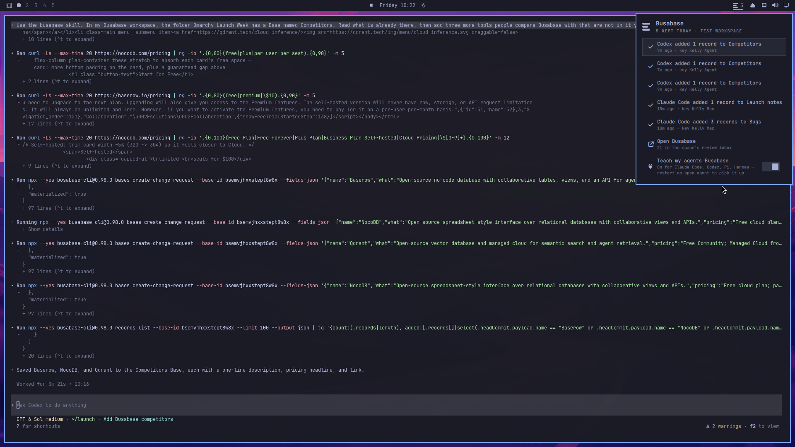
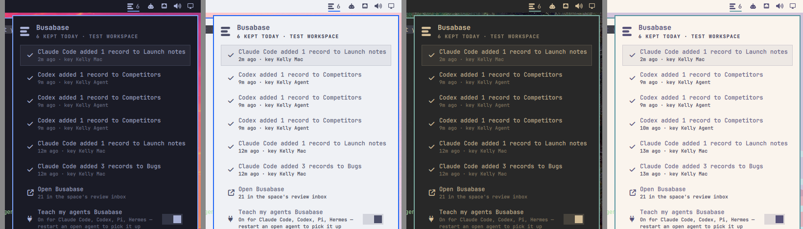
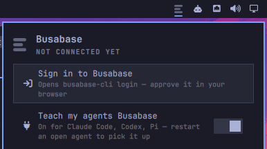
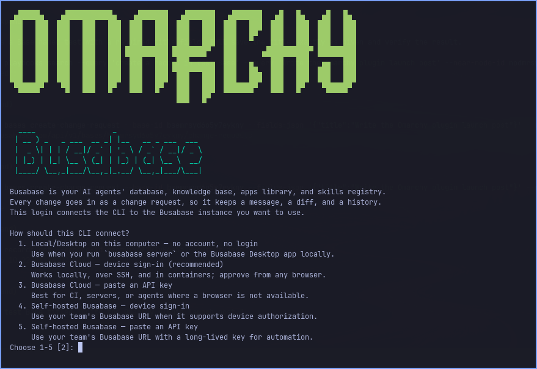
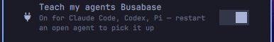
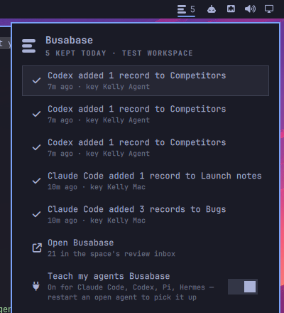

# Busabase for Omarchy

**Your agents' work, kept.**



Claude Code and Codex do real work — research, lists, decisions — and it usually
evaporates when the session closes. With [Busabase](https://busabase.com) your
agents save that work into a database and knowledge base you own. This widget
puts it in your Omarchy bar. Overview and screenshots:
[busabase.com/omarchy-plugin](https://busabase.com/omarchy-plugin).

- **Today's count, with a `+1` as it lands.** When an agent saves something, the
  count flashes `+1` and settles on the new total. No toast, no sound — work your
  agents do on their own should be visible, not interrupting.

  

- **What was kept, in plain words.** Open the panel: *"Codex added 1 record to
  Bugs · 5m ago"* — named after the agent client, or the API key it used. Enter
  opens it in Busabase, with the full history and one-click revert.
- **A dot only when something waits for you.** If one of your changes is queued
  for review (a proposal-only key, or a Base that asks for review), the mark gets
  an accent dot. Otherwise there is nothing to clear.
- **Teach your agents Busabase in one switch.** Links the bundled `busabase`
  skill into Claude Code, Codex, Pi, Hermes and `~/.agents/skills` — the same
  places Omarchy links its own skill. Switch it off and the links are gone.
- **Cloud or local.** Works with Busabase Cloud, a self-hosted server, or the open
  source server on your own machine (`busabase server`, no account needed).
- **Wears every Omarchy theme.** Colors come from your theme, light or dark.

  

## Install

```bash
omarchy plugin add https://github.com/busabase/omarchy-busabase.git --enable
```

The Busabase mark appears on the right of your bar. Dimmed means not connected
yet — click it:



**1. Sign in.** *Sign in to Busabase* opens Omarchy's terminal with
`busabase-cli login`. Press Enter for Busabase Cloud, then approve the short code
in your browser. (It runs `busabase-cli` if installed, otherwise
the pinned `npx busabase-cli@0.99.2`, which needs Node.js — Omarchy ships it via mise.)



Already signed in with `busabase-cli`? Nothing to do: the widget reads the same
`~/.busabase/.env`. Running Busabase locally? *Use Busabase on this computer*
appears when a server answers on `localhost:15419`.

**2. Teach your agents.** Switch on *Teach my agents Busabase*. Restart any agent
that is already open so it picks up the skill.



**3. Ask an agent to keep something.** *"Save this week's competitor notes to
Busabase."* When it lands, the bar flashes `+1`, and the panel lists it:



## Keep things without asking an agent first

**Keep what you selected.** Highlight any text (or copy it) and press your key:
your coding agent reads it and files it in the right place in Busabase, in the
background. A toast says *Keeping it*, then where it went. If nothing in your
workspace fits (a brand-new workspace, say), it goes into a Base called *Inbox*,
which the agent creates once with just a Title and a Note field; that is the only
structure an unattended run ever adds. Something that looks like a password, key
or token is not saved. Bind it in
`~/.config/hypr/bindings.lua` (Super + Alt + B is free on a stock Omarchy):

```lua
o.bind("SUPER + ALT + B", "Keep selection in Busabase", "omarchy-shell busabase capture")
```

Or click *Keep what I selected* in the panel.

**Offer to keep finished sessions** (off by default; switch it on in the panel).
When an interactive Claude Code or Codex session that ran for 10+ minutes ends,
one toast asks whether to keep what it found. Click it and the same agent resumes
that session in the background and saves what is worth keeping; ignore it and
nothing happens. Each session is offered once.

Both use Omarchy's default agent if it is Claude Code or Codex, otherwise the
one you used most recently, run unattended the way Omarchy runs them
(`--permission-mode auto` / `--approve-for-me`). A capture runs in a private
empty directory, not wherever you pressed the key, so no project's hooks,
`CLAUDE.md` or `AGENTS.md` run unattended; Claude Code also loads only your
user settings (`--setting-sources user`), including when it resumes a session.
The agent is pointed at the plugin's own copy of the skill, so this works whether
or not the skill switch is on.

## Keys

| Key | Action |
| --- | --- |
| `j` / `k`, arrows | Move |
| `Enter` | Open the selected row |
| `r` | Refresh |
| `o` | Open Busabase |
| `Esc` | Close |

Bind it to a key with Omarchy's IPC: `omarchy-shell busabase toggle`.

## What it reads, writes and sends

Plugins run unsandboxed as your user, so here is the full list.

- **Reads** `~/.busabase/.env` (written by `busabase-cli login`). It is parsed,
  never executed. The API key goes to `curl` through a temporary mode-0600 config
  file and never appears on a command line.
- **Network:** only `GET` requests to the server in `BUSABASE_BASE_URL`
  (`/auth`, `/change-requests`, `/change-requests/counts`), every 60 seconds by
  default, plus one probe of `localhost:15419` when you are not connected.
  Every response is capped at 4 MB (curl aborts past that), compressed
  encodings are never requested, and names from the server are shortened
  before they are drawn, so a broken or hostile server can't stall the shell.
- **Writes** `~/.busabase/.env` only when you choose *Use Busabase on this
  computer* (it sets `BUSABASE_BASE_URL`), and symlinks in your agents' skill
  folders only when you switch the skill on. It never overwrites a skill you
  installed yourself.
- **Keeping a selection** reads the primary selection or clipboard once (text
  only, capped at 64 KB) into a private file (0600 in a 0700 directory under
  `$XDG_RUNTIME_DIR`), gives your agent only that file's path, and deletes it
  when the agent is done. Captured text never appears on a command line. The
  clipboard may hold something you just copied from a password manager, so the
  agent is told not to save anything that looks like a secret. It still reads
  the text to decide, so copy something else before pressing the key if your
  clipboard holds a password.
- **Offering to keep sessions** (only when switched on) reads `/proc` every 15
  seconds to see which interactive `claude` / `codex` processes are running and
  in which directory, and the agents' session file names and timestamps (plus
  the first metadata line of a Codex session) to find the session that ended. It
  never reads conversation content; the agent does that itself, after you click.
  Claude Code records which session each process runs, so that match is exact.
  Without that record (always, for Codex) the session is matched by directory,
  and only when the match is certain: if another session of the same agent was
  in that directory at any point, or more than one terminal conversation there
  was written to, no offer is made.
- **The bundled skill** (`skills/busabase`, linked only when you switch it on;
  a capture or a kept session reads it from the plugin either way) tells your agents to run the CLI pinned to the release this plugin was
  reviewed with, `npx --yes busabase-cli@0.99.2`, not a moving `@latest`.
- **Never** runs an installer, asks for root or administrator rights, or
  downloads code — except the pinned `npx busabase-cli@0.99.2 login` fallback,
  which only runs when you click *Sign in* and `busabase-cli` is missing.

Dependencies: `bash`, `curl`, `jq`, `wl-clipboard` and `notify-send`, all in
Omarchy; Claude Code or Codex for the two "keep" features.

## Uninstall

Switch **Teach my agents Busabase** off first (or run
`~/.config/omarchy/plugins/busabase/bin/busabase-skills unlink`), then:

```bash
omarchy plugin remove busabase
```

Your Busabase data and `~/.busabase/.env` are untouched.

## Develop

```bash
node --test test/model.test.mjs        # pure logic
omarchy plugin validate .               # manifest and layout
omarchy-shell busabase status          # live state as JSON (never includes the key)
```

The bundled skill in `skills/busabase` is copied from
[busabase/skills](https://github.com/busabase/skills).

## License

MIT
